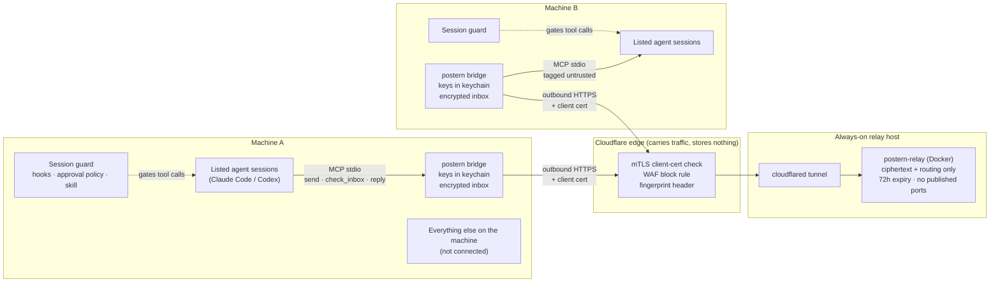

# postern

A postern is the small guarded side gate in a castle wall. This is one for AI agents: a narrow, encrypted door that lets agent sessions on two different machines, under two different accounts, exchange messages (handoffs, review requests, questions, status) without opening either machine's internal network.

## How it works



### A message, end to end

```mermaid
sequenceDiagram
  autonumber
  actor HA as Human A
  participant SA as Session A
  participant BA as Bridge A
  participant E as Edge
  participant R as Relay
  participant BB as Bridge B
  participant SB as Session B
  actor HB as Human B

  HA->>SA: "Ask peer-b to review branch x"
  SA->>HA: Shows exact subject and body
  HA->>SA: Approves
  SA->>BA: send(to, subject, body)
  Note over BA: secret scan · rate limit · thread cap<br/>seal with NaCl box to peer-b's pinned key
  BA->>E: POST /v1/msg + client cert
  Note over E: no valid, unrevoked cert = blocked here
  E->>R: via tunnel, cert fingerprint header
  Note over R: from must match the cert's peer<br/>ts within 10 min · id not seen · store ciphertext
  BB->>E: long-poll GET /v1/poll + client cert
  E->>R: via tunnel
  R-->>BB: envelope
  Note over BB: open with pinned key · check sealed routing fields<br/>dedup · store encrypted · ack
  HB->>SB: "Check Postern"
  Note over SB: guard taints the session before check_inbox runs
  SB->>BB: check_inbox
  BB-->>SB: message inside untrusted_content<br/>origin=external, trust=untrusted
  SB->>HB: Summary of what it asks; waits
  Note over SB,HB: every later tool call asks Human B<br/>until Human B types /postern-clear
```

## Pieces

- **Bridge** (`postern`): one native binary per machine. Each listed agent session starts `postern mcp --session NAME`, which exposes `send`, `check_inbox`, `reply` and `mark_read`. Messages are sealed with NaCl box to the peer's pinned public key, and routing fields are authenticated inside the box. Keys live only in the macOS keychain, and the local inbox is encrypted at rest. Outgoing messages that look like secrets are blocked, never redacted. Rate limits and a per-thread circuit breaker stop agent loops.
- **Relay** (`postern-relay`): a small Go HTTP service (post, long-poll, ack) in Docker on an always-on machine, behind a Cloudflare Tunnel, with no published ports. It stores ciphertext and routing fields only, expires everything after 72 hours, binds every request to the peer named by its client certificate, and rejects replays and timestamps more than 10 minutes off.
- **Edge**: Cloudflare client certificates (mTLS) and a WAF rule reject any request without a valid, unrevoked certificate before it reaches the relay.
- **Session guard**: inbound messages are always tagged `origin=external, trust=untrusted` and framed as data. In Claude Code, hooks make every tool call ask the human once untrusted content is in the session, until the human clears it. In Codex, the project is marked untrusted so commands need approval. A `postern` skill for both tells the agent how to handle messages.
- **Config pin**: the bridge refuses to start if its config changed since the human pinned it. The pin is an HMAC under a keychain-held key, so it cannot be forged by writing a keychain item by hand. Changing trust (peers, sessions, keys, the pin) needs Touch ID or the login password in a system dialog that an agent cannot answer.

## Quick start

```sh
make build && sudo install -m 0755 bin/postern /usr/local/bin/postern

postern init --peer-name peer-a --relay-url https://postern.example.com --session build
postern peer add --name peer-b --public-key '<KEY>' --fingerprint '<FINGERPRINT>'   # compared out of band
postern cert import peer-a.pem                                                      # issued from init's CSR
postern edge-check

claude mcp add postern -- /usr/local/bin/postern mcp --session build
postern guard install --project /path/to/project     # Claude Code hooks, /postern-clear, skill
postern guard install-codex                          # Codex skill; see examples/codex/config.toml
```

Full walkthrough, rotation and the revocation drill: [docs/operations.md](docs/operations.md). Relay and edge: [docs/edge-setup.md](docs/edge-setup.md). Guard details: [docs/session-guard.md](docs/session-guard.md).

## Commands

| Command | Purpose |
|---|---|
| `postern init` | Generate keys in the keychain, write and pin the config, print public key, fingerprint and CSR |
| `postern show` | Identity, certificate, sessions and peers |
| `postern peer add/remove`, `postern session add/remove` | Change who the bridge trusts (asks for Touch ID or the login password) |
| `postern cert csr [--new-key]`, `postern cert import FILE` | Client certificate issue and weekly rotation |
| `postern config pin` | Review and re-pin the config after a change you made |
| `postern edge-check` | Verify the edge blocks uncertified and forged requests and the relay binds identity |
| `postern thread reset THREAD` | Lift a tripped thread circuit breaker |
| `postern guard install`, `postern guard install-codex` | Install the session guard and skill |
| `postern mcp --session NAME` | MCP server for one agent session (started by the agent tool) |
| `postern hook EVENT` | Claude Code hook entry point (run by Claude Code) |
| `postern-relay -config FILE` | The relay (runs in Docker) |

## Layout

```
cmd/postern          bridge CLI and MCP server entry point
cmd/postern-relay    relay entry point and Docker healthcheck
internal/envelope    sealing, authenticated routing fields, limits
internal/relay       relay HTTP API, store, identity binding, long-poll
internal/bridge      encrypted inbox, outbox, poller, limits, relay client
internal/mcpserver   MCP tools and untrusted framing
internal/guard       Claude Code hooks, installer, postern skill
internal/scan        outgoing secret scanner
internal/secrets     macOS keychain store
internal/config      bridge config and keyed pin
internal/presence    Touch ID / login password approval for trust changes
internal/cli         all postern commands
internal/e2e         end-to-end tests through the real relay
docker-compose.yml   relay + cloudflared (internal network, no published ports)
deploy/              example relay and tunnel config
docs/                edge setup, session guard, operations, plans
examples/            session rule, Claude Code settings, Codex config
```

## Build and test

```sh
make build          # bin/postern, bin/postern-relay
make test           # all tests, offline
make race           # with the race detector
make vet            # go vet + gofmt check
make keychain-test  # touches the real macOS login keychain (throwaway items)
make relay-image    # docker compose build relay
```

Requires Go 1.26. The bridge needs macOS (keychain via cgo); the relay builds for Linux without cgo.

## Status

v0 is implemented and tested. Every security property in [PLAN.md](PLAN.md) has a test, including an end-to-end run of two bridges through the real relay over mTLS and an injection and exfiltration fixture against the guard.

Not done yet:

- Verification against the real Cloudflare edge (`postern edge-check` after [docs/edge-setup.md](docs/edge-setup.md)), and the same-day revocation drill before the first real peer.
- A `docker compose build` of the relay image on the relay host.
- v1 items in [PLAN.md](PLAN.md): audit log, hardware-bound keys, bridge under a separate OS user, `postern wait`.

Design and threat model: [DESIGN.md](DESIGN.md). Known residual risks: [docs/operations.md](docs/operations.md#residual-risks-v0) and [docs/session-guard.md](docs/session-guard.md#residual-risks).
